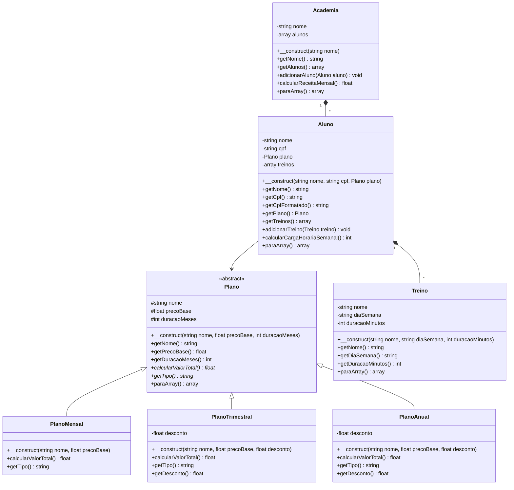

# Modelagem

## Diagrama de classes

Legenda: `<|--` herança ("é um"), `*--` composição ("tem um"), `#` protected, `-` private, `+` public.

## Justificativas

### Herança

A classe mãe é `Plano` (abstrata), e as filhas são `PlanoMensal`, `PlanoTrimestral` e `PlanoAnual`. A frase "é um" se aplica naturalmente:

- **PlanoMensal é um Plano** — com duração de 1 mês e sem desconto.
- **PlanoTrimestral é um Plano** — com duração de 3 meses e 10% de desconto.
- **PlanoAnual é um Plano** — com duração de 12 meses e 20% de desconto.

O método sobrescrito é `calcularValorTotal()`: cada filha implementa o cálculo de forma diferente. O `PlanoMensal` retorna o preço-base diretamente; o `PlanoTrimestral` multiplica por 3 e aplica 10% de desconto; o `PlanoAnual` multiplica por 12 e aplica 20% de desconto. O método `getTipo()` também é sobrescrito para retornar a string identificadora de cada tipo.

### Composição

Existem duas relações de composição:

1. **Aluno tem Treinos** — Um aluno guarda uma lista de objetos `Treino`. A relação é "tem um" (e não "é um"), porque um aluno não é um treino. O método `adicionarTreino()` permite incluir treinos e `calcularCargaHorariaSemanal()` calcula a soma dos minutos de todos os treinos.

2. **Academia tem Alunos** — A academia guarda uma lista de objetos `Aluno`. O método `adicionarAluno()` permite incluir alunos e `calcularReceitaMensal()` calcula a receita mensal estimada com base nos planos de todos os alunos.

### Encapsulamento

Nenhum atributo é `public`:

- **Atributos `protected`** (na classe `Plano`): `nome`, `precoBase` e `duracaoMeses` — são acessíveis pelas filhas para cálculos internos, com getters públicos (`getNome()`, `getPrecoBase()`, `getDuracaoMeses()`). Não possuem setters, pois um plano não deve ter seu preço ou duração alterados após a criação.
- **Atributos `private`** (em `Aluno`, `Treino`, `Academia`, `PlanoTrimestral`, `PlanoAnual`): todos acessíveis apenas via getters. O atributo `desconto` em `PlanoTrimestral` e `PlanoAnual` tem getter mas não setter, pois o desconto é definido na criação e não deve mudar. O `cpf` do aluno não tem setter, pois é imutável. Os `treinos` do aluno são adicionados pelo método `adicionarTreino()` com validação, e não por setter direto.
